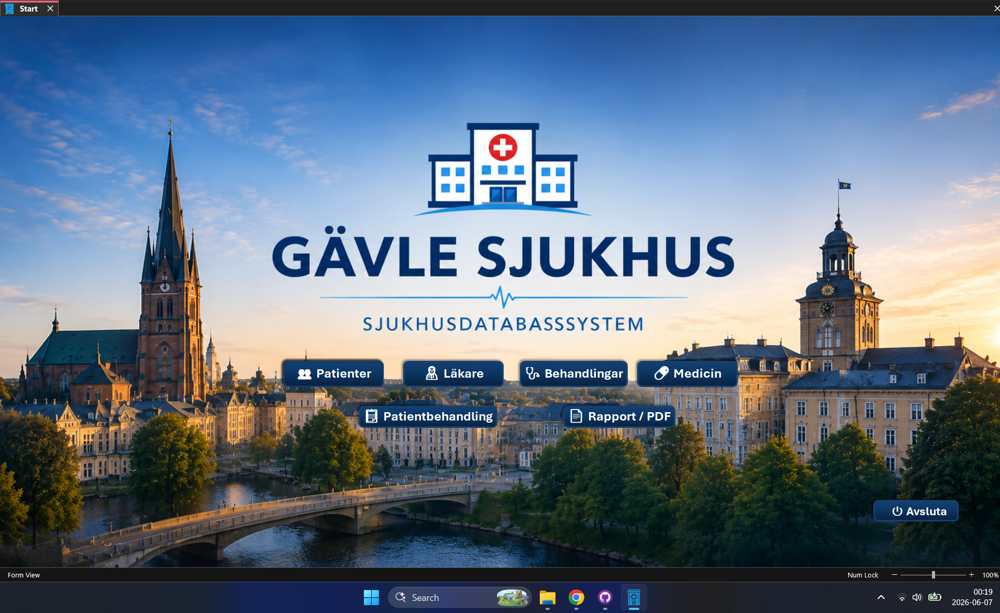
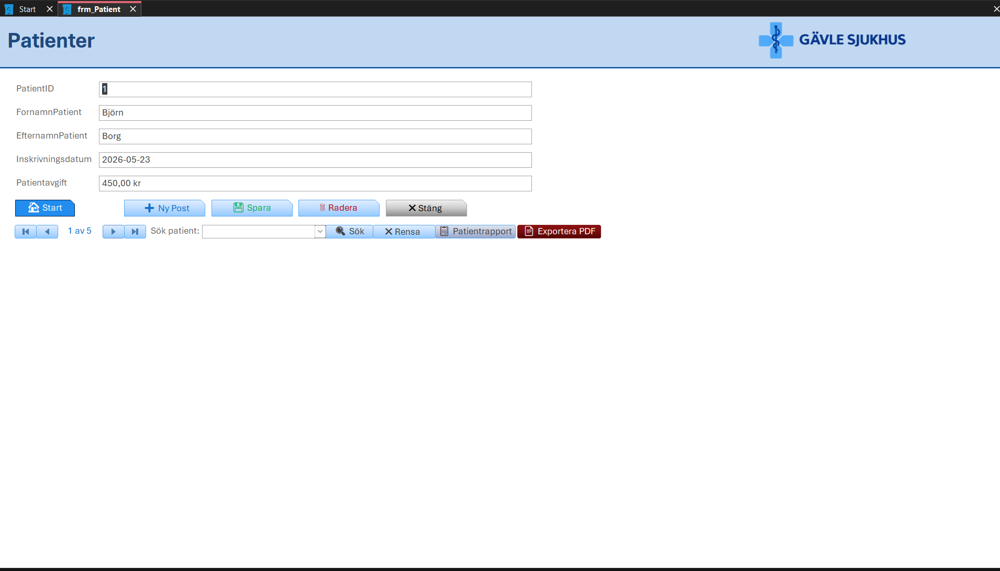
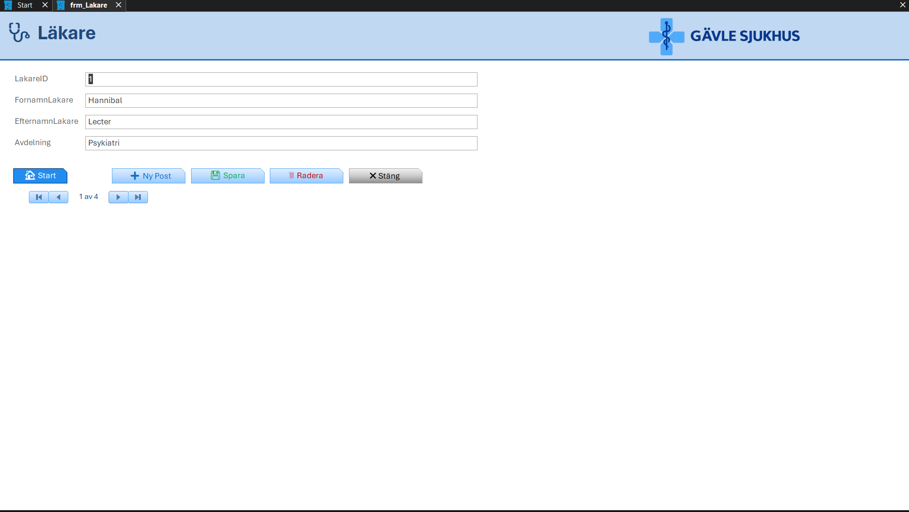
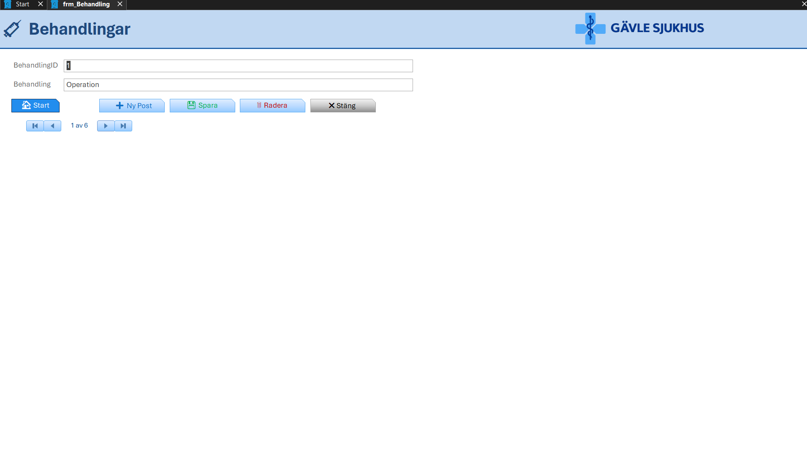
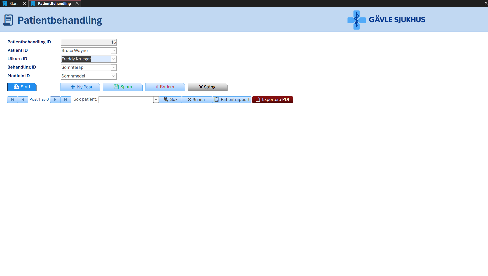
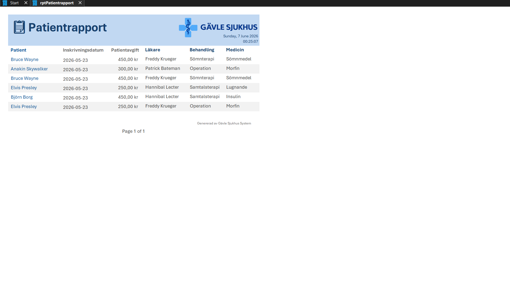

# Gävle Sjukhus – Access Databas

Detta är ett databasprojekt skapat i Microsoft Access. Projektet är byggt som ett sjukhussystem med frontend/backend-struktur, formulär, rapporter, sökfunktioner och PDF-export.

## Starta och prova projektet

1. Ladda ner projektfilerna från mappen `Github_Upload`.
2. Placera `Gavle_Sjukhus_FE.accdb` och `Gavle_Sjukhus_BE.accdb` i samma mapp.
3. Öppna frontend-filen i Microsoft Access.
4. Kontrollera eventuella frågor om länkade tabeller och säkerhetsvarningar innan du tillåter makron eller VBA.

**Säkerhet:** Aktivera endast innehåll och makron om du litar på filens ursprung och har kontrollerat vad den innehåller.

## Funktioner

- Startsida med navigering
- Patientregister
- Läkarregister
- Behandlingsregister
- Medicinregister
- Patientbehandling
- Sökfunktion
- Rensa filter
- Rapportvisning
- Export till PDF
- Separat frontend och backend
- Anpassad ikon och grafisk design

## Tekniker

- Microsoft Access
- VBA
- SQL
- Relationsdatabas
- Frontend/backend-uppdelning
- GitHub

## Skärmbilder

### Startsida

### Patienter

### Läkare

### Behandlingar

### Patientbehandling

### Patientrapport

## Filer

Databasfilerna finns i mappen `Github_Upload`.

- `Gavle_Sjukhus_FE.accdb` – frontend med formulär, rapporter och VBA
- `Gavle_Sjukhus_BE.accdb` – backend med tabeller och data
- `Gävle_Ikon_Logo.png` – projektets logga
- `Hospital_Icon.ico` – ikonfil
- `Startmeny_Bild_Gävle.png` – bild för startsidan

## Portfolio och demonstration

Den här databasen visar relationsdatabaser, användargränssnitt och automation i ett Access-projekt. Bilderna ovan ger en snabb överblick utan att besökaren behöver öppna databasen.

Se också min [personliga IT-portfolio](https://jakobozmen.github.io/Lexicon_Project/) och min [GitHub-profil](https://github.com/jakobozmen).

## Kontrollera data innan offentlig delning

Både backendfilen och frontenden ligger i ett **offentligt** GitHub-repository. Om filer innehåller patientuppgifter, personuppgifter, interna dokument eller inloggningsuppgifter måste dessa tas bort och datan anonymiseras innan delning. Här har innehållet i Access-filerna **inte** granskats; de ska därför inte beskrivas som verifierat anonymiserade.

## Syfte

Syftet med projektet är att visa kunskap inom databasdesign, relationsdatabaser, formulärdesign, VBA-programmering och användarvänliga gränssnitt i Microsoft Access.

## Skapad av

Jakob Özmen
